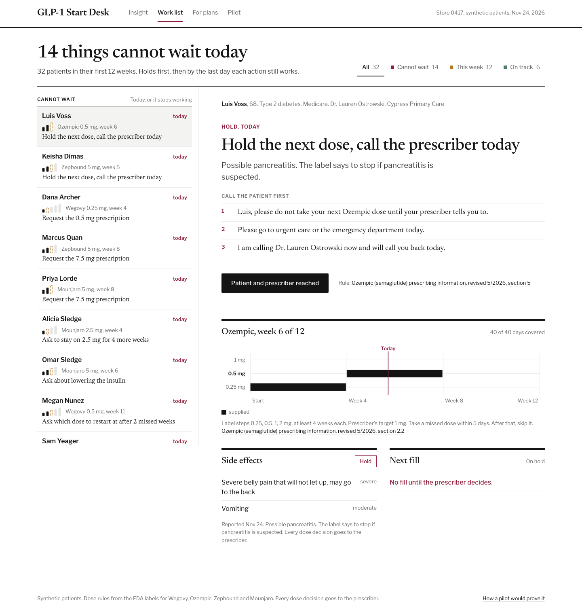

# GLP-1 Start Desk

A pharmacist's working desk for the first 12 weeks of GLP-1 therapy. It answers one question at the counter each morning: which of my new GLP-1 patients needs something today, and what exactly do I do?

More than 30% of new starts stopped within 4 weeks in Blue Health Intelligence's commercial claims, while the dose was still going up, and most did not reach 12 weeks ([BHI issue brief, May 2024](https://www.bcbs.com/sites/default/files/BHI_Issue_Brief_GLP1_Trends.pdf)). Each step up is a new strength, so it needs a new prescription, often a new prior authorization, sometimes stock the store does not carry, and brings a new round of nausea. Those are counter problems, and they have dates.

The patients are synthetic. No real patient, prescriber or claim is used. Dose rules come from the FDA labels for Wegovy, Ozempic, Zepbound and Mounjaro ([docs/SOURCES.md](docs/SOURCES.md)).



## What it does

- **Today.** Every patient in weeks 0 to 12, with one next action each: hold, fax the prescriber, call the patient, or nothing today. Holds come first, then each action by the last day it still works.
- **Dose step due.** Reads the label's ladder (Wegovy 0.25, 0.5, 1, 1.7, 2.4 mg, tirzepatide 2.5 mg steps), never steps up before 4 weeks on the current dose, and stops at the prescriber's target.
- **Days covered and refill gap.** Days supplied since the first fill, when the supply runs out, and the label's missed-dose window (Wegovy 2 days, Ozempic 5, tirzepatide 4). After two or more missed weeks, the Wegovy label says to restart lower, and the other labels leave it to the prescriber, so the desk asks.
- **Side effects and the tolerability decision.** Red flags (possible pancreatitis, gallbladder, fluid loss, thyroid cancer history, pregnancy) mean hold the next dose and call the prescriber today. Low sugars on insulin or a sulfonylurea mean ask about lowering that drug. Moderate stomach effects before a step mean ask to stay on the current dose 4 more weeks. Mild means continue with self-care.
- **Blockers before the next fill.** No prescription for the next strength, a prior authorization that names only the starting strength or ends first, a savings card that runs out, the next strength out of stock, and Medicare with weight as the only use, which Part D excludes and the Medicare GLP-1 Bridge may cover.
- **What to say.** Each call has a script, and each fax is written out. Tirzepatide patients on the pill hear the label's 4-week backup advice at the start and around each step.
- **Short-staffed mode.** On a bad staffing day the desk shows only what cannot wait, and lists everything else with the last day it can wait until.
- **For plans.** What a plan or employer buys per member, the monthly record it gets, what buyers pay for this today with sources, and the arithmetic for what must be true for the fee to pay back.

The pharmacist never changes a dose. Every dose decision is a request to the prescriber, unless a collaborative practice agreement says otherwise.


## What's checked

- **Label schedules and missed-dose windows** match each label section (`tests/labels.test.js`).
- **Rules.** Step timing, early refills carried forward, holds ahead of everything, slow-down only on moderate effects, low sugars only with insulin or a sulfonylurea, the Wegovy restart rule and its absence on the other labels, the tirzepatide contraceptive advice, the Part D weight exclusion (`tests/desk.test.js`).
- **Every action names its rule**, and every clinical rule links to the label or CMS page it came from.
- **Every fax asks.** None changes a dose.
- **No outcome claims.** A guard test fails if the README, docs or app present an outcome number as the desk's result.
- **Plain prose.** A guard test fails on local paths, em dashes, or semicolons in docs and in anything the desk writes.

## How a pilot would prove it

The desk makes no outcome claim yet. This is the test that would earn one.

1. **Pick stores** in pairs matched on weekly GLP-1 starts and pharmacist hours, and flip a coin within each pair. Randomizing stores, not patients, keeps one pharmacist from carrying the desk's habits to usual-care patients.
2. **Usual care** gets counseling at pickup as stores give it today. **Desk stores** work the daily list, faxes and calls.
3. **Log every action** the desk proposed and whether it happened by its date, prescriber replies and days to reply, side effects and decisions, reasons for any stop, pharmacist minutes, and whether the store was short-staffed that day.
4. **Main measure:** share of new starts with supply covering week 12, from claims, by arm. Also: reaching week 12 with no unplanned restart, days from step due to the next strength on file, side-effect stops, red flags sent the same day, and drug dollars spent on people who stopped before a maintenance dose.

**Stop rules, set in advance.** Any red flag without same-day prescriber contact pauses enrollment for clinical review. Stop adding stores if desk stores miss their must-today actions on short-staffed days two weeks running. Stop if a set share of prescribers ask to stop the faxes. An independent statistician checks at the halfway point and stops for futility if the margin is out of reach.

Size it from the stores' own prior-year week 12 rate, and write down the margin that would justify selling it before the first patient. Both arms keep usual counseling, and every dose decision stays with the prescriber.

## What it can't do

- **It has no outcome evidence yet.** The pilot is how to get it.
- **It does not prescribe.** Without a collaborative practice agreement, every step is a prescriber request, which adds days.
- **Its timing rules are planning rules.** A prescriber is assumed to answer a fax within 2 business days, and check-ins a few days after each step are pharmacist practice, not a label rule. The pilot measures both.
- **It reads what the store has.** Fills, prescriptions on file, prior authorization and stock from the pharmacy system, and side effects the patient reports. No labs, weights or clinic notes.
- **It covers four injectables.** Not oral semaglutide, orforglipron or compounded products.
- **It does not grade severity for the pharmacist.** Mild, moderate and severe come from the conversation, and the pharmacist's judgment stays in charge.
- **The payer case is not medical savings.** Prime found no medical cost offset at 3 years. The case is a higher share of drug dollars reaching a working dose, plus an auditable record.

## Run it

```bash
npm install
npm run build   # builds the synthetic patients' data, then the app
npm run dev     # prints a local address, open it
npm test        # label rules, desk rules, the guards
```

## Stack

React and Vite, plain JavaScript, Vitest. The engine in `src/engine` has no dependencies. It shares its layout and guard tests with [Stars Desk](https://github.com/kvmadden/stars-desk).

## License

MIT
